# AWS Terraform Build Guide
I started this project by creating a directory after installing and initilizing AWS CLI and Terraform in my MAC OS teminal. I also made sure terraform could access AWS using linked account credentials

## Phase 1: Terraform Configuration
### Configuring the AWS Provider
I created and configured 'terraform.tf' to specify Terraform and AWS Provider version requirements/constraints and the deployment region ('us-east-1').

## Phase 2: VPC Configuration
My VPC was configured in main.tf with a resource block specifing 'aws_vpc' as the resource type. In the block I am choosing my CIDR block to be 10.0.0.0/16. I also created a Name tag to give my vpc a name. Below is the config: 

After saving the file and running `terraform validate` to check if configuration is structurally valid and `terraform plan` to check for changes and I recieved this: 

## Phase 3: VPC Deployment and Verification
### VPC Deployment
I used `terraform apply` to deploy vpc into cloud environment and got the following message from CLI:

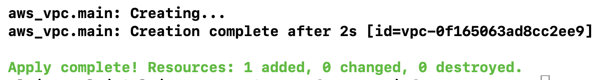

### VPC Verification
I then went into my AWS account VPC console in `us-east-1` region and confirmed VPC was created with expected configuration: 
-Name: `terraform-project-vpc`
-IPv4 CIDR block `10.0.0.0/16` 

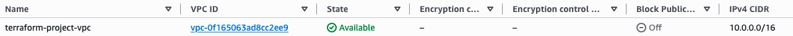

## Phase 4: Subnet Design and Deployment
### Planning 
Four things I needed to design and deploy my subnet were
 1. picking 4 subnets (1 public / 1 private for each AZ). 
 2. picking 2 AZ in my region
 3. write subnet configurations into main.tf
 4. validate, plan, and deploy with terraform
### My Subnets
My two private subnets are: 10.0.1.0/24 for AZ 1 and 10.0.2.0/24 for AZ 2
My two public subnets are: 10.0.11.0/24 for AZ 1 and 10.0.12.0/24 for AZ 2
### My AZ in us-east-1
AZ 1: us-east-1a (use1-az1)
AZ 2: us-east-1b (use1-az2)

### Configuring Subnets 
In the main.tf file, I created 4 `aws_subnet` resource blocks to make the private and public subnets in each of 2 Availability Zones. The screenshot below shows how this was accomplished:

### Validating Subnets Configs with Terraform
After formating my file, validating for issues and using `terraform plan`, this is what I got:

### Creating Subnets and Confirming
Changes were applies to AWS:

I checked my account and verified:

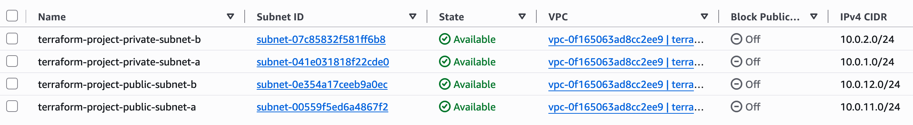

## Phase 5: Internet Gateway and Route Configuration
### Objective
In this phase, I declared my internet gateway (igw), routing tables, and subnet-to-routing table association

### Internet Gateway
- The VPC needs a IGW because it is how the subnet and its resources access the internet
- I attacked my IGW to the VPC I created at the beginning
- The terraform resources I used were `aws_internet_gateway`
### Route Table Configuration
- A public and private subnet were created seperately so the public route table can be applied to the publlic subnet. This way, traffic in the public subnet can be routed to the internet
- In the public route table I configured 0.0.0.0/0 traffic to target the IGW
- I did not include this config in the private route table because that will only contain local traffic
 - I used the `aws_route_table` resource
 ### Subnet Associations
 - I associated each public and private subnet to its corresponding routing table
 - I used the `aws_route_table_association` resource to do so
### Validation and deployment
- After formating and validating my terraform files, this is what I got with `terraform plan`:
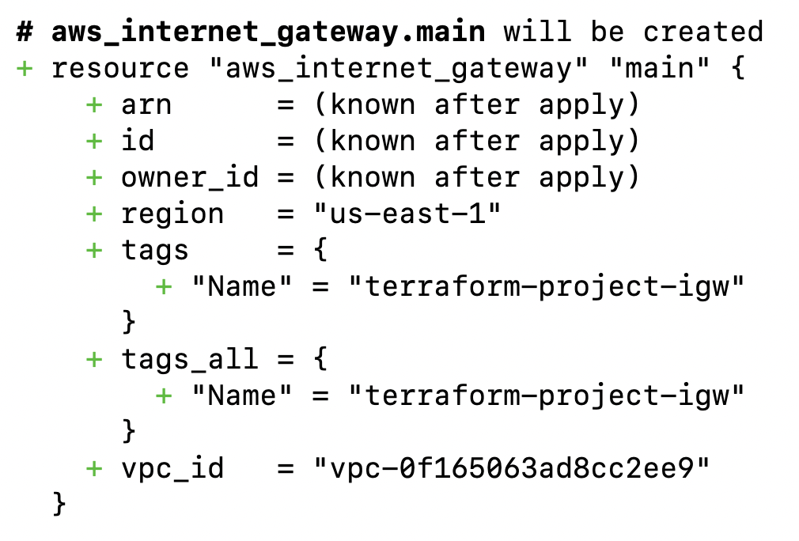
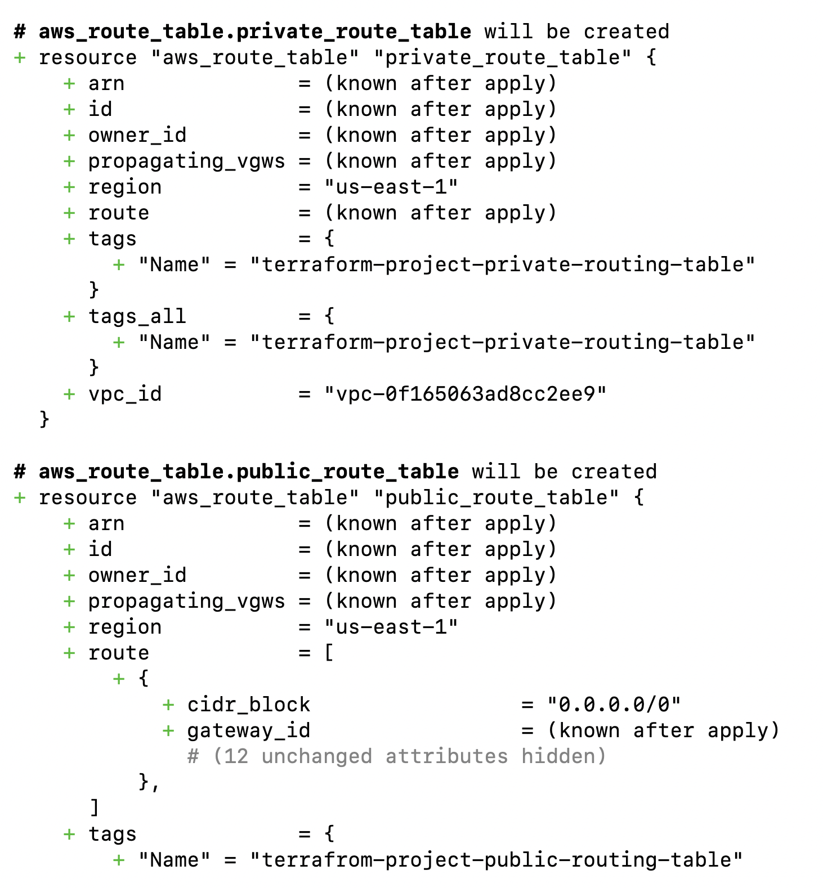
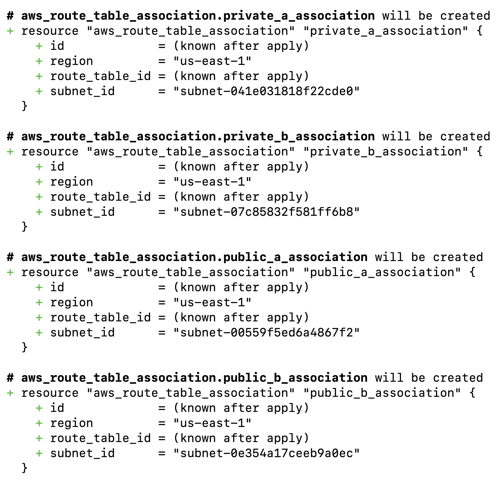
- Now after validating my terraform plan output, I did `terraform plan`
### AWS verification
Now I went ahead and ensured that both the IGW and route tables were created and that subnets were associated with the proper route tables as seen below.
- IGW:
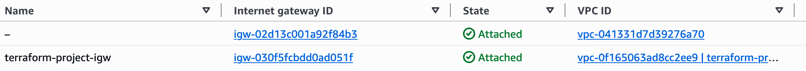
- Routing Table
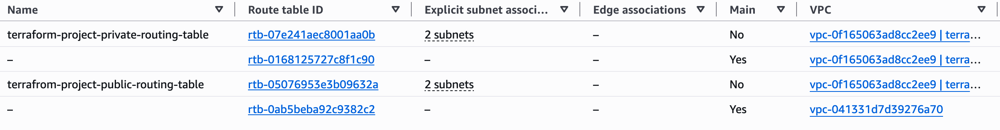
- Associations
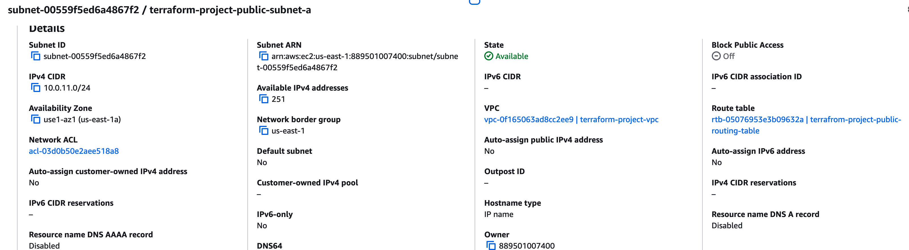

## Phase 6: Network Security Configuration
### Objective 
Design network level access controls for the infrastructure so that future public facing resources and private EC2 instances only accept the traffic they actually need.
### Security Group
The purpose of a security group is to control inbound and outbound traffic for AWS resources using Layer 3 and Layer 4 rules. Security groups are stateful, meaning return traffic for an allowed connection is automatically permitted.
### Security Groups Created
For this project, I created two Security Groups. One for the Application Load Balancer and one for the EC2 instance
### ALB Security Group Ingress Configuration
- Protocol: TCP
- Port: 443
- Source: 0.0.0.0/0
Used 0.0.0.0/0 because we want to make it possible for all internet traffic to reach out app
- TCP was used as the protocol instead of HTTPS because we need the transport protocol not the application protocol
### Traffic Between ALB and EC2 Security Group
- TCP port 80 will be used by the future application between the ALB and EC2 instances.
- The EC2 security group references the ALB security group as its source, allowing TCP port 80 traffic only from resources associated with the ALB security group.
- The ALB security group's outbound rule references the EC2 security group, allowing the ALB to send TCP port 80 traffic to the application servers.

### Creating Separate Resources for SG Rules

When configuring security groups, Terraform provides the option to define rules within the security group itself or create the rules as separate resources and associate them with a security group.

I decided to use separate security group rule resources after finding that referencing the security groups within each other created a circular dependency.

The standalone `aws_vpc_security_group_ingress_rule` and `aws_vpc_security_group_egress_rule` resources resolved this issue by allowing Terraform to create both security groups independently before creating the rules that reference them. This removes the direct dependency between the two security group resources while still allowing traffic to be restricted based on the source or destination security group.
### Validating Configuration
In the snipet below you can see the `terraform plan` output for my security group showing the creation of the group and the rule: 

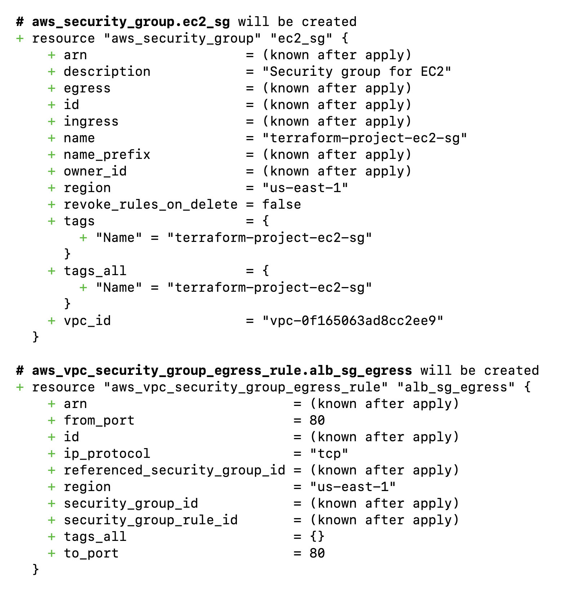

### Applying The Changes
After validating the plan I went ahead and applied with `Terraform Apply` and got this: 

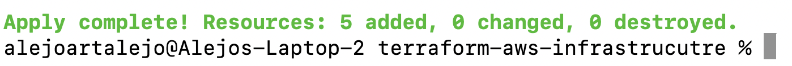

### Verifying Changes Made In AWS Console
Verification of Security Group creation:

Verification of Security Group rules:

