# AWS Terraform Build Guide
I started this project by creating a directory after installing and initilizing AWS CLI and Terraform in my MAC OS teminal. I also made sure terraform could access AWS using linked account credentials

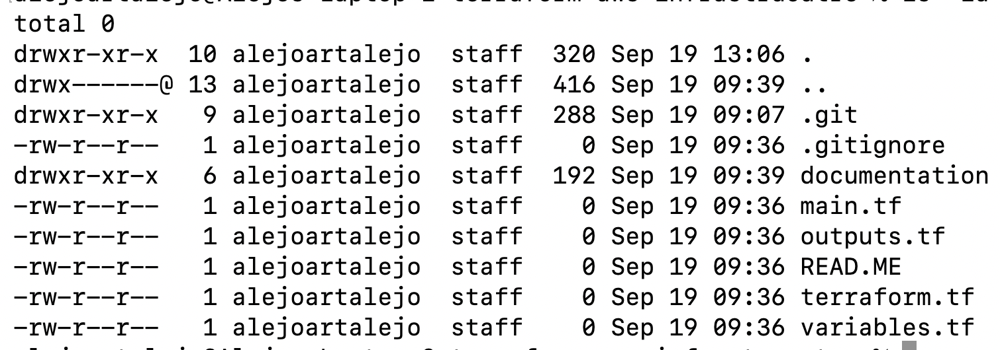

## Phase 1: Terraform Configuration
### Configuring the AWS Provider
I created and configured 'terraform.tf' to specify Terraform and AWS Provider version requirements/constraints and the deployment region ('us-east-1').

## Phase 2: VPC Configuration
My VPC was configured in main.tf with a resource block specifing 'aws_vpc' as the resource type. In the block I am choosing my CIDR block to be 10.0.0.0/16. I also created a Name tag to give my vpc a name. Below is the config: 

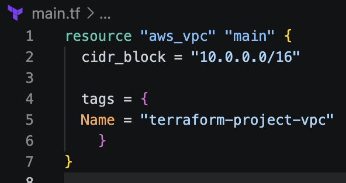

After saving the file and running `terraform validate` to check if configuration is structurally valid and `terraform plan` to check for changes and I recieved this: 

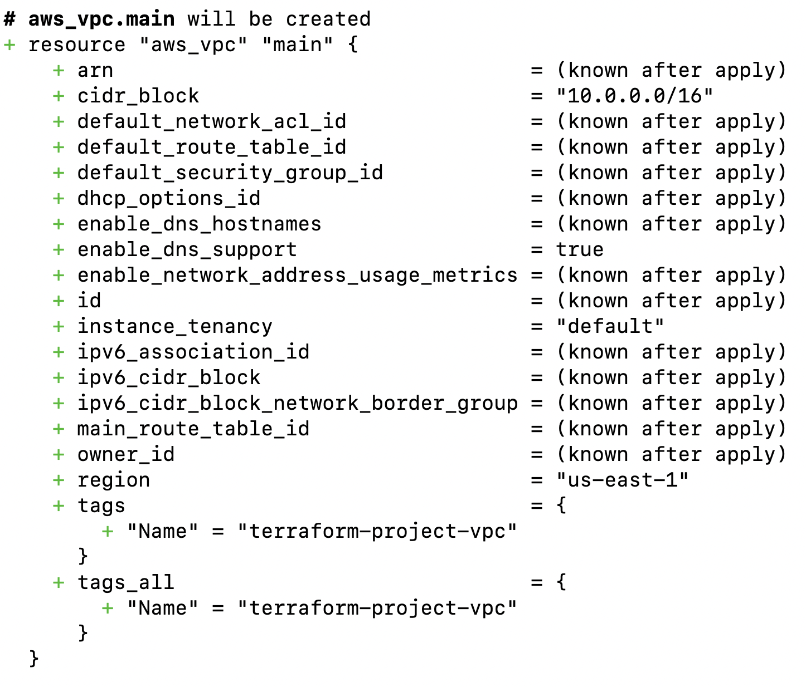

## Phase 3: VPC Deployment and Verification
### VPC Deployment
I used `terraform apply` to deploy vpc into cloud environment and got the following message from CLI:

### VPC Verification
I then went into my AWS account VPC console in `us-east-1` region and confirmed VPC was created with expected configuration: 
-Name: `terraform-project-vpc`
-IPv4 CIDR block `10.0.0.0/16` 

## Phase 4: Subnet Design and Deployment
### Planning 
Four things I needed to design and deploy my subnet were
 1. picking 4 subnets (1 public / 1 private for each AZ). 
 2. picking 2 AZ in my region
 3. write subnet configurations into main.tf
 4. validate, plan, and deploy with terraform
### My Subnets
My two private subnets are: 10.0.1.0/24 for AZ 1 and 10.0.2.0/24 for AZ 2
My two public subnets are: 10.0.11.0/24 for AZ 1 and 10.0.12.0/24 for AZ 2
### My AZ in us-east-1
AZ 1: us-east-1a (use1-az1)
AZ 2: us-east-1b (use1-az2)

### Configuring Subnets 
In the main.tf file, I created 4 `aws_subnet` resource blocks to make the private and public subnets in each of 2 Availability Zones. The screenshot below shows how this was accomplished:

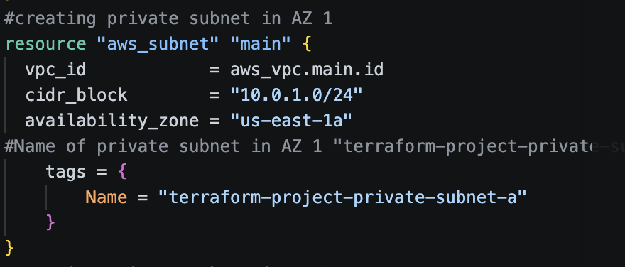

### Validating Subnets Configs with Terraform
After formating my file, validating for issues and using `terraform plan`, this is what I got:

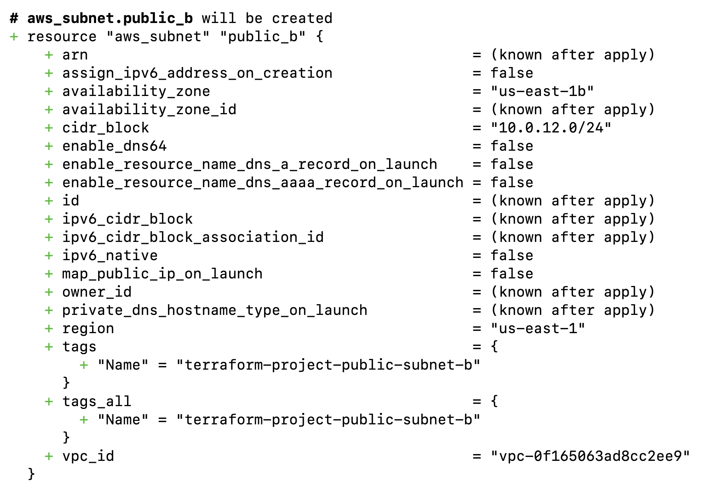

### Creating Subnets and Confirming
Changes were applies to AWS:

I checked my account and verified:

## Phase 5: Internet Gateway and Route Configuration
### Objective
In this phase, I declared my internet gateway (igw), routing tables, and subnet-to-routing table association

### Internet Gateway
- The VPC needs a IGW because it is how the subnet and its resources access the internet
- I attacked my IGW to the VPC I created at the beginning
- The terraform resources I used were `aws_internet_gateway`
### Route Table Configuration
- A public and private subnet were created seperately so the public route table can be applied to the publlic subnet. This way, traffic in the public subnet can be routed to the internet
- In the public route table I configured 0.0.0.0/0 traffic to target the IGW
- I did not include this config in the private route table because that will only contain local traffic
 - I used the `aws_route_table` resource
 ### Subnet Associations
 - I associated each public and private subnet to its corresponding routing table
 - I used the `aws_route_table_association` resource to do so
### Validation and deployment
- After formating and validating my terraform files, this is what I got with `terraform plan`:

- Now after validating my terraform plan output, I did `terraform plan`
### AWS verification
Now I went ahead and ensured that both the IGW and route tables were created and that subnets were associated with the proper route tables as seen below.
- IGW:

- Routing Table

- Associations

## Phase 6: Network Security Configuration
### Objective 
Design network level access controls for the infrastructure so that future public facing resources and private EC2 instances only accept the traffic they actually need.
### Security Group
The purpose of a security group is to control inbound and outbound traffic for AWS resources using Layer 3 and Layer 4 rules. Security groups are stateful, meaning return traffic for an allowed connection is automatically permitted.
### Security Groups Created
For this project, I created two Security Groups. One for the Application Load Balancer and one for the EC2 instance
### ALB Security Group Ingress Configuration
- Protocol: TCP
- Port: 443
- Source: 0.0.0.0/0
Used 0.0.0.0/0 because we want to make it possible for all internet traffic to reach out app
- TCP was used as the protocol instead of HTTPS because we need the transport protocol not the application protocol
### Traffic Between ALB and EC2 Security Group
- TCP port 80 will be used by the future application between the ALB and EC2 instances.
- The EC2 security group references the ALB security group as its source, allowing TCP port 80 traffic only from resources associated with the ALB security group.
- The ALB security group's outbound rule references the EC2 security group, allowing the ALB to send TCP port 80 traffic to the application servers.

### Creating Separate Resources for SG Rules

When configuring security groups, Terraform provides the option to define rules within the security group itself or create the rules as separate resources and associate them with a security group.

I decided to use separate security group rule resources after finding that referencing the security groups within each other created a circular dependency.

The standalone `aws_vpc_security_group_ingress_rule` and `aws_vpc_security_group_egress_rule` resources resolved this issue by allowing Terraform to create both security groups independently before creating the rules that reference them. This removes the direct dependency between the two security group resources while still allowing traffic to be restricted based on the source or destination security group.
### Validating Configuration
In the snipet below you can see the `terraform plan` output for my security group showing the creation of the group and the rule: 

### Applying The Changes
After validating the plan I went ahead and applied with `Terraform Apply` and got this: 

### Verifying Changes Made In AWS Console
Verification of Security Group creation:

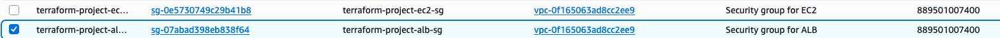

Verification of Security Group rules:

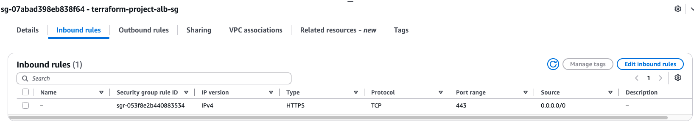
## Phase 7: EC2 Launch Template & IAM Configuration
### Objective
The goal of this phase was to Create and EC2 Template with the proper IAM role and pofile to then later attach together.
The structure looks something like this:

**IAM Role --> EC2 Profile --> EC2 Template**
### IAM Role
The EC2 doesn't require a IAM role, but it is recommneded to restrict what anyone using the EC2 can do. I attached `AmazonSSMManagedInstanceCore` to ensure I can manage my resources and access my VM via a Web interface.
### Instance Profile
An instance profle is needed for an EC2, because an IAM role can't attach directly to an EC2 template, only a profile.
### Launch Template
The launch template I created configures a couple of settings I want for my app:
- AMI: Amazon Linux 2023
- instance type: T3.micro
- security group: terraform_project-ec2-sg
- instance profile: terraform-project-ec2-instance-profile
- user data: bash script to start and enable nginx web server once machine boots
### AMI Selection
note: instead of hard coding the current Amazon Linux 2023 version into the template, I used aws ssm parameter to call the latest version of the machine and use that.
### User Data
wrote a script to automatically confogire the machine when it launches. Now the web app will automatically start on port 80 and opens index.html page.
### Security
I did not include a SSH/key pair in my template because I will be using SSSM Manager to access my machines via a web browser. The instance will also be launched in a private subnet to keep it inaccessible from the internet.
### Validation
Below are photos of the `terraform plan` output:

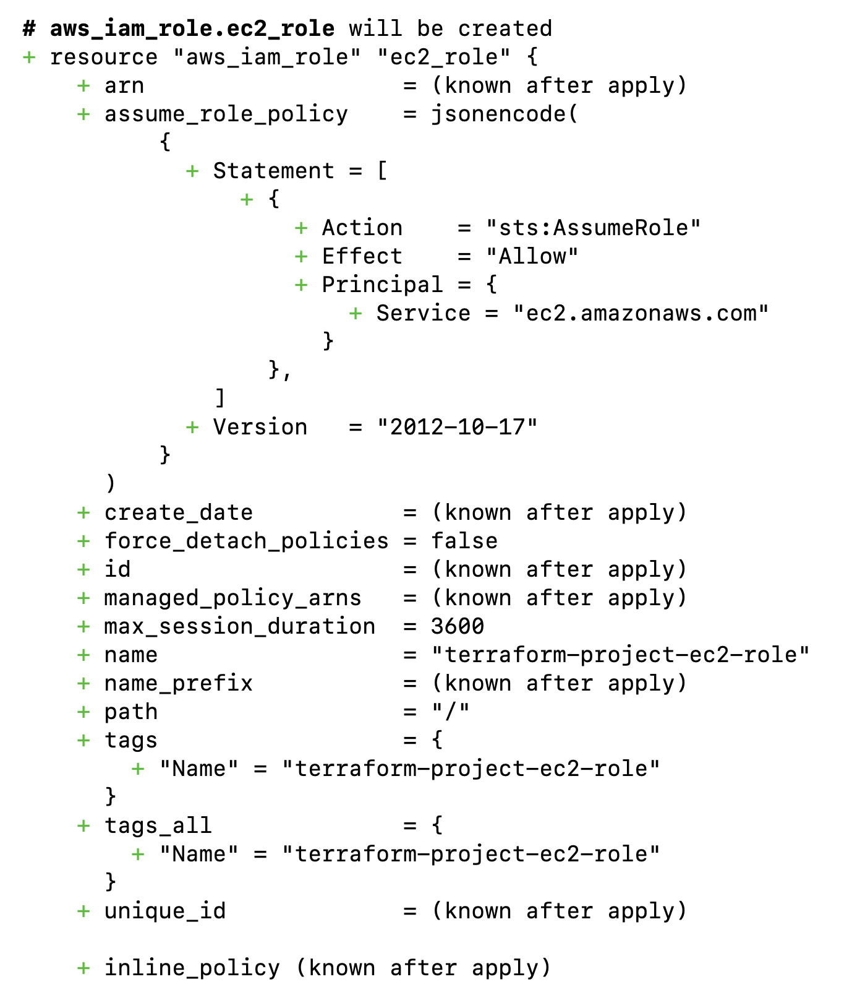
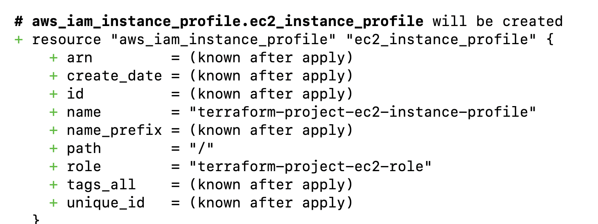
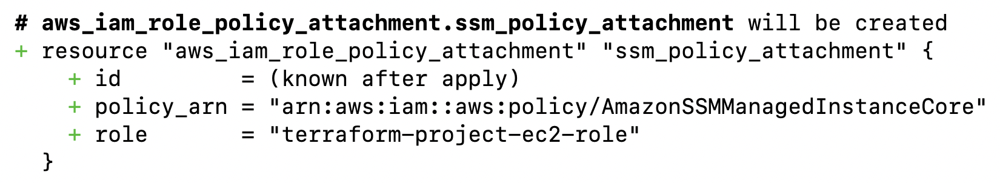
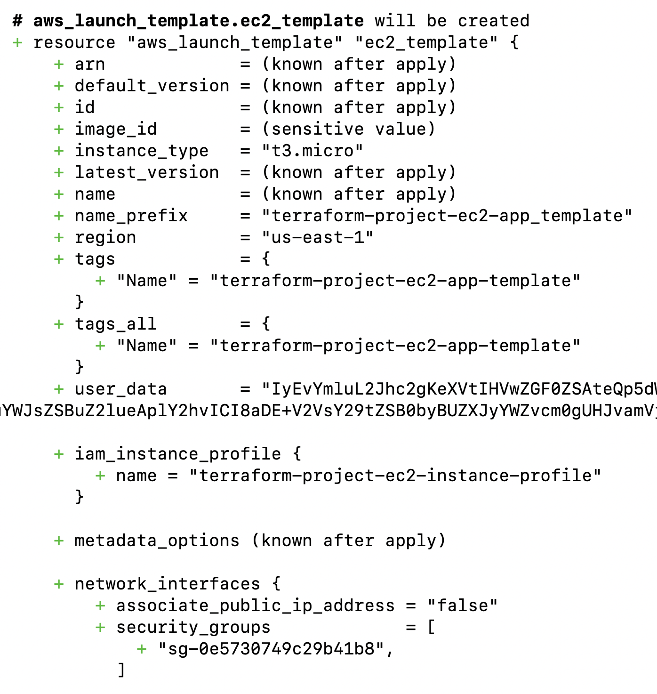

After making sure all the changes looked good, I went ahead and ran `terraform plan` and went to aws console to verify changes as seen below: 

### IAM Profile
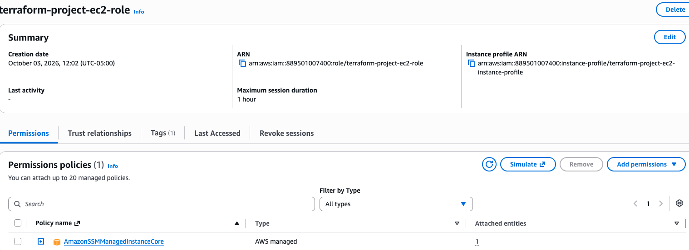
### Instance Profile
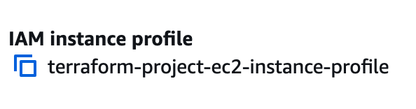
### SSM to IAM Association
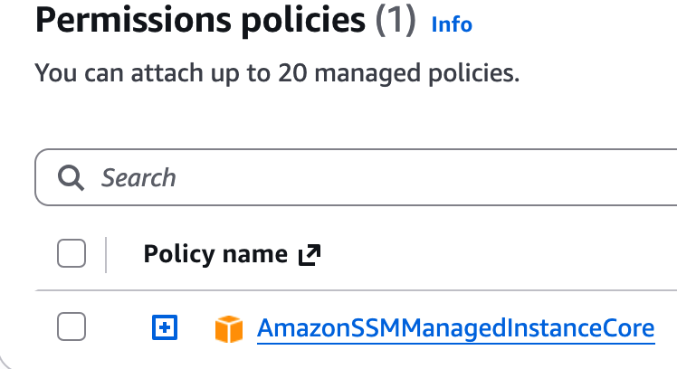
### EC2 Template
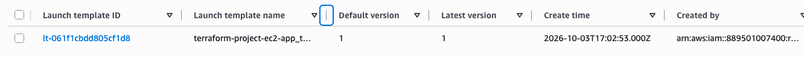

## Phase 8: Application Load Balancer (ALB) Configuration
### Objective
In Phase 8, the plan was to configure my load balancer, a domain to reach the alb, a target group, and a listener
### Architecture
I chose an Application Load Balancer (ALB) instead of a Network Load Balancer (NLB) because the load balancer will act as a gateway between an untrusted zone and a trusted zone but will only be recieving application data.

I placed the ALB across 2 public subnets to provide redundancy and availability.

Traffic will flow from the internet, to my ALB, using the domain I created, app.artalejolabs.com. Within the ALB I configured a listener to get status updates from the target groups to know when and where to send the traffic to. The target groups contain my EC2 apps which will process web app requests.

### Application Load Balancer
The resource I used to create my load balancer was `aws_lb` as seen from terrafrom plan below: 

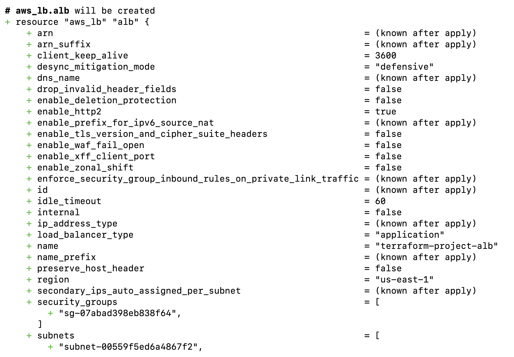

notes: 
- `internal = false` means it is public facing
- associated with existing alb security group to apply traffic permissions to the load balancer
### Target Group and Health Checks
Like I mentioned above, the purpose of a target group if for the load balancer to know where to send traffic. This is where the ec2 hosting my web app will be placed.

The health check config found inside this resource is to query the machines to make sure they are responsive.

I did not manually register my EC2 instances with a target group through my EC2 template because it will be the job of my ALB to place my machines where they would best fit.
### ACM Certification
AWS Certificate Manager (ACM) is a service that manages the issuance and renewal of SSL/TLS certificates. I used ACM to secure HTTPS connections between users and my Application Load Balancer.

I requested a certificate for app.artalejolabs.com because artalejolabs.com is my main domain, and I wanted to use a dedicated subdomain for my web application.

I registered my domain through Porkbun and created a CNAME record using the name and value provided by ACM. AWS used this DNS record to verify that I controlled the domain before issuing my certificate.

The difference the ACM Validation CNAME and the CNMAE that points my app domain to the ALB is that the first one proves my ownership of the domain and issues me a cert and the scond one directs resolved traffic to my ALB
### HTTPS Listener and Security
The purpose of `aws_lb_listener` is to listen to incoming request for the load balancer using configured port and protocols. The certificate is added to the listener to recieve connections.

I configured the listener to used port 443 to accept connections using protocol https.

I selected `ELBSecurityPolicy-TLS13-1-2-2021-06` because it allows TLS 1.3 and TLS 1.2 encryption.

The default action I configured on the listener allows traffic to pass as a last resort path.
### Terraform Validation and Results
#### Below is the planning of all the parts of Phase 8:

**creating CNAME using ACM**

**registering domain on porkbun**

**adding acm cname to porkbun**

**configuring ALB**

**configuring ALB listener**

**configuring ALB target group**

#### Below is the verification of `terraform apply`
**ALB creation**

**ALB listener**

**ALB Target Group**

### Pushing changes to GitHub
Before moving on to Phase 9 of this project, I wanted to commit changes to my github repo. 

To do this I had to first download git on my device and use `git init` in my directory to enable version control and add hidden .git files. 

After doing so, I connected my remote branch using `git remote add origin <github_repo_url>`

To stage changes I would first use `git add .`

To save a snapshot of those changes in Git history I used `git commit -m "message"`

To upload commits to GitHub I use `git push origin <branch_name>

Since I had already pushed commits to my repo, all I need to do now were those last 3 steps as seen below:

**Adding and commiting changes**

**Pushing changes to GitHub**

